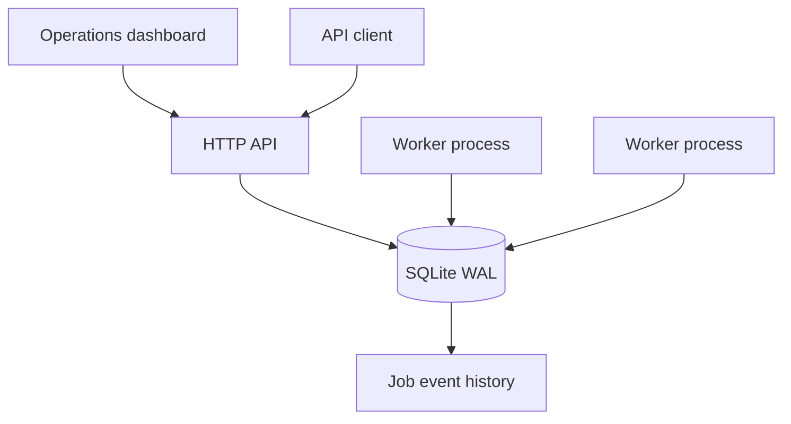
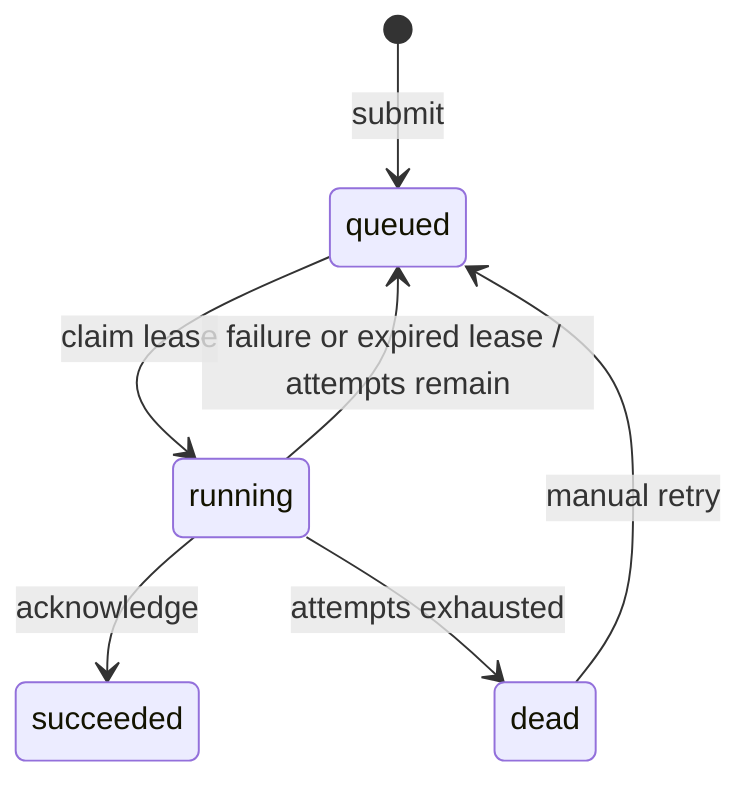

# RelayQueue

### Background work with durable state and an inspectable failure path.

A Python job-processing service with an HTTP API, operations dashboard, SQLite persistence, and independently runnable workers. The focus is correctness when requests repeat, workers race, processes restart, or a handler fails.

**Python · SQLite · HTTP API · JavaScript dashboard · Docker Compose**

## Try it in two terminals

Requires Python 3.11+. No third-party Python packages or cloud account required.

```bash
python server.py
```

```bash
python worker.py
```

Open **http://127.0.0.1:8080**. Submit an `echo` job, inspect its event history, then submit a `fail` job to watch retries and the dead-letter state. Stop and restart either process: persisted jobs remain in `relayqueue.db`.

## What is implemented

| Capability | Behavior |
|---|---|
| Durable submissions | Jobs and event history commit together |
| Idempotency | Same key and request return the original job; different request returns HTTP 409 |
| Concurrent workers | Atomic claim transaction assigns one live lease token per job |
| Crash recovery | A later claim requeues expired leases or marks exhausted jobs dead |
| Stale-worker fencing | Completion requires an unexpired, matching lease token |
| Retries | Exponential backoff of 1, 2, 4… seconds, capped at 60 |
| Dead-letter handling | Exhausted jobs remain inspectable and can be retried manually |
| Operations | Queue counts, job details, event history, and manual retry in the dashboard |
| Deployment | Separate API and worker containers share a persistent volume |

## Architecture





### Why these decisions matter

- **Transaction boundary:** `BEGIN IMMEDIATE` covers claim selection, state mutation, and event insertion. Workers execute the handler after committing, outside the database lock.
- **Delivery semantics:** execution is **at least once**. A handler may perform a side effect and crash before acknowledging. External side effects must be idempotent. Lease fencing protects queue state, not an external payment or email service.
- **Durability:** WAL with `synchronous=FULL`; one connection per operation, with explicit rollback on errors. Durability still depends on the storage system honoring synchronization.
- **Scope:** SQLite keeps the demo easy to inspect and run. It serializes writers and is intended here for one host with a local persistent filesystem. This is not a multi-region queue or a benchmarked replacement for a managed broker.

See [architecture and invariants](docs/architecture.md) and [deployment notes](docs/deployment.md).

## API example

```bash
curl -X POST http://127.0.0.1:8080/api/jobs \
  -H 'Content-Type: application/json' \
  -H 'Idempotency-Key: demo-001' \
  -d '{"kind":"sha256","payload":{"document":"example"},"max_attempts":3}'
```

Repeat the request to receive the same job. Change the payload while retaining the key to receive a conflict.

| Endpoint | Purpose |
|---|---|
| `GET /health` | Connectivity and state counts |
| `GET /api/jobs` | Latest 100 jobs |
| `POST /api/jobs` | Submit a job |
| `GET /api/jobs/{id}` | Inspect a job |
| `GET /api/jobs/{id}/events` | Inspect lifecycle history |
| `POST /api/jobs/{id}/retry` | Requeue a dead job; JSON body `{}` |

Set `RELAYQUEUE_TOKEN` to require bearer authentication for API access. Binding outside loopback requires a token. The dashboard keeps the entered token in memory, not local storage. Deploy behind a TLS reverse proxy; the included HTTP server is for local demonstration, not an internet-facing hardened edge.

## Containers

```bash
export RELAYQUEUE_TOKEN="$(python -c 'import secrets; print(secrets.token_urlsafe(32))')"
docker compose up --build
```

Enter the token in the dashboard. Both services mount `queue-data` at `/data`. Container configuration is included; a live cloud deployment and container-build validation are not claimed.

## Verification

```bash
python -m unittest discover -s tests -v
python -m compileall -q .
```

The tests cover concurrent submissions and claims, idempotency conflicts, restart persistence, stale and expired acknowledgments, backoff, dead-letter recovery, authentication, API validation, and dashboard delivery. CI runs the suite on Python 3.11–3.13.

## Repository guide

| Path | Responsibility |
|---|---|
| `queue_store.py` | Transactional persistence and lifecycle transitions |
| `server.py` | API validation, authentication, and dashboard assets |
| `worker.py` | Allowlisted handlers and worker process |
| `dashboard.js`, `index.html`, `style.css` | Operations interface |
| `tests/` | State-machine, concurrency, and HTTP integration tests |
| `docs/` | Design decisions and operating limits |
| `.github/workflows/` | Automated verification |

## Deliberate limits and next work

Handlers are short, allowlisted local functions, not arbitrary uploaded code. There is no lease heartbeat: a handler that runs beyond the 30-second lease can be executed again. Expiry recovery happens during worker claims. Idempotency keys and events currently have no retention policy. Next steps are cancellation, lease renewal, paginated history, and a PostgreSQL storage adapter with equivalent concurrency tests.
